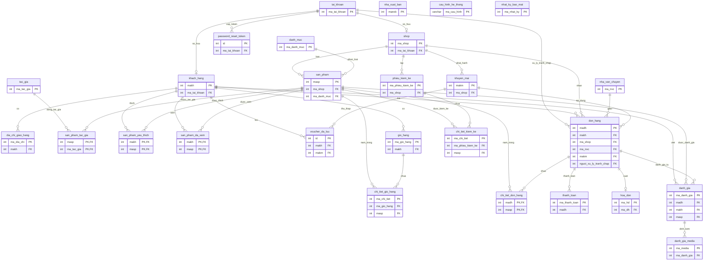

# SƠ ĐỒ QUAN HỆ CƠ SỞ DỮ LIỆU (ERD) — THE4BOOKSTORE
**Hệ thống:** The4BookStore E-Commerce & Marketplace  
**Hệ quản trị CSDL:** Microsoft SQL Server (T-SQL)  
**Mô hình:** Sàn Thương Mại Điện Tử Đa Gian Hàng (Multi-Vendor Marketplace)  
**Phân quyền (4 Roles):** `ADMIN`, `MANAGER`, `VENDOR`, `KHACHHANG`  
**Ghi chú:** Đã loại bỏ hoàn toàn mô hình kho tập trung (`KHO`, `KHO_HANG`, `yeu_cau_cap_hang`, `chi_tiet_cap_hang`) và phân hệ nhân viên cũ (`nhan_vien`). Toàn bộ tồn kho do từng Shop tự quản trị (`san_pham.so_luong_ton`, `phieu_kiem_ke`).

---

